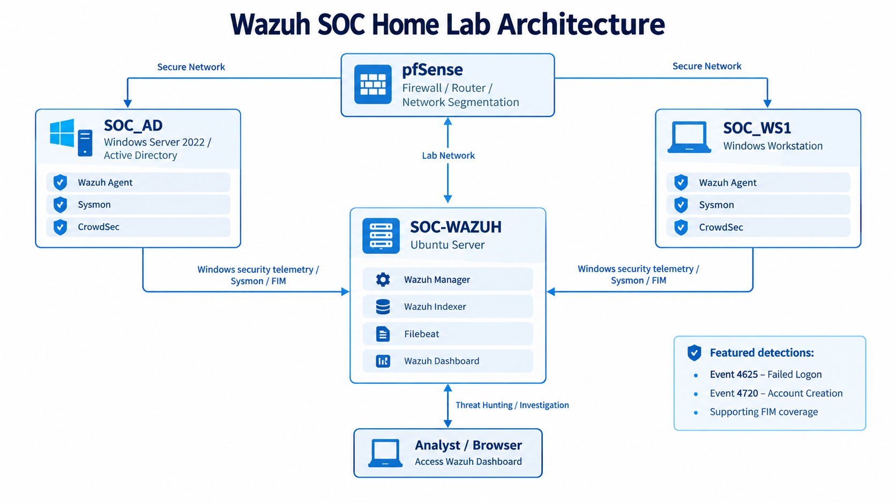

# Wazuh SOC Home Lab

A hands-on Security Operations Center (SOC) home lab built around **Wazuh 4.14.8** to demonstrate endpoint telemetry, Active Directory monitoring, authentication detection, File Integrity Monitoring (FIM), alert triage, and evidence-driven investigation.
 
## Project Overview

This lab simulates a small enterprise SOC with a segmented lab network, Windows endpoints, an Active Directory domain controller, and a centralized Wazuh monitoring stack.

### Endpoint roles

|System|Role|Security tooling|
|-|-|-|
|`SOC_AD`|Windows Server 2022 / Active Directory|Wazuh Agent, Sysmon, CrowdSec|
|`SOC_WS1`|Windows 10 Pro workstation|Wazuh Agent, Sysmon, CrowdSec|
|`Windows-Host`|Additional Windows 11 telemetry endpoint|Wazuh Agent|
|`pfSense`|Firewall / router / network segmentation|Network security boundary|

### Wazuh stack

`SOC-WAZUH` is the Ubuntu server hosting:

* Wazuh Manager
* Wazuh Indexer
* Filebeat
* Wazuh Dashboard

The Wazuh dashboard is used for alert triage, Threat Hunting, event inspection, and investigation.

## Architecture



### Telemetry flow

1. `SOC_AD` and `SOC_WS1` generate Windows security telemetry.
2. Wazuh Agents collect and forward endpoint events to `SOC-WAZUH`.
3. Wazuh Manager analyzes the events and applies detection rules.
4. Filebeat forwards the manager’s alerts to Wazuh Indexer.
5. Wazuh Indexer stores the forwarded alerts for search and investigation.
6. The Wazuh Dashboard provides centralized triage and investigation.
7. The analyst uses Threat Hunting to pivot from alert → raw event → investigation details.

## Detection Scenarios

### 1. Failed Logon — Windows Event ID 4625

**Scenario:** A failed authentication attempt was generated against `SOC_AD` using a test account.

**Observed telemetry:**

* Windows Security Event ID: `4625`
* Agent: `SOC_AD`
* Wazuh rule: `60122`
* Rule level: `5`
* Detection: `Logon Failure - Unknown user or bad password`
* Authentication package: `NTLM`
* Logon type: `3`
* Test account: `Wazuh-Invalid-Test`

**Evidence:**

* [Filtered 4625 alert](evidence/detections/failed-logon-4625.png)
* [4625 investigation details](evidence/detections/failed-logon-4625-details.png)

### 2. Account Creation — Windows Event ID 4720

**Scenario:** A new domain account was created on `SOC_AD` to validate Active Directory change monitoring.

**Observed telemetry:**

* Windows Security Event ID: `4720`
* Agent: `SOC_AD`
* Wazuh rule: `60109`
* Rule level: `8`
* Detection: `User account enabled or created`
* Test account: `WazuhTestUser`
* Initiating user: `Administrator`

**Evidence:**

* [Filtered 4720 alert](evidence/detections/account-creation-4720.png)
* [4720 investigation details](evidence/detections/account-creation-4720-details.png)

## Supporting Security Coverage

Although the portfolio highlights two detection workflows, the lab also validates additional SOC capabilities:

* **File Integrity Monitoring:** realtime file change detection on `SOC_WS1`
* **Sysmon:** detailed Windows process and event telemetry on both primary endpoints
* **CrowdSec:** endpoint behavioral defense and Windows Firewall bouncer on both primary endpoints
* **SCA / Configuration Assessment:** security configuration visibility
* **MITRE ATT&CK:** detection context and technique mapping in Wazuh
* **Threat Hunting:** searchable alert and event investigation

## Investigation Workflow

The project follows a repeatable analyst workflow:

```text
Endpoint activity
      ↓
Wazuh Agent collection
      ↓
Wazuh Manager rule evaluation
      ↓
Alert generated
      ↓
Threat Hunting / filtering
      ↓
Raw event inspection
      ↓
Context + rule + ATT&CK review
      ↓
Document evidence and findings
```

## Lab Networking

The Wazuh server uses a persistent host-only interface for dashboard access.

Example lab-management address:

```text
SOC-WAZUH host-only: 192.168.56.103/24
```

The repository does not include private keys, certificates, credentials, raw alert databases, VM disks, or other sensitive lab artifacts.

## Repository Structure

```text
Wazuh-SOC-Home-Lab/
├── README.md
├── .gitignore
├── architecture/
│   └── architecture.png
├── configuration/
│   ├── network-config.md
│   └── wazuh-agent-config.md
├── detections/
│   └── detection-matrix.md
└── evidence/
    ├── dashboard/
    │   ├── overview.png
    │   └── agents-active.png
    └── detections/
        ├── failed-logon-4625.png
        ├── failed-logon-4625-details.png
        ├── account-creation-4720.png
        └── account-creation-4720-details.png
```

## What This Project Demonstrates

This project is designed to demonstrate practical SOC skills rather than simply installing a SIEM:

* Endpoint onboarding and health validation
* Windows Security event analysis
* Active Directory monitoring
* Authentication failure triage
* Account-change monitoring
* File Integrity Monitoring
* Threat Hunting and event filtering
* Raw event investigation
* Rule and MITRE ATT&CK context review
* Evidence collection and security documentation
* Secure public-repository hygiene

## Lessons Learned

* A SOC platform is most useful when endpoint telemetry is reliable and searchable.
* Alert triage should be driven by context, not just alert counts.
* Raw event fields are important for validating what actually happened.
* Detection evidence should connect the endpoint activity, Wazuh rule, and investigation context.
* Public SOC projects must separate useful evidence from sensitive infrastructure data.

## Limitations

This is a home-lab environment and does not represent a full production SOC. It uses a small number of endpoints, locally generated test activity, and a simplified network design.

## Future Improvements

Potential next steps include:

* Additional Windows detection engineering
* Custom Wazuh rules
* Sigma-to-Wazuh rule translation
* More realistic attack simulations
* Automated response playbooks
* Centralized ticketing / case management
* Additional network telemetry and pfSense log ingestion

## Author Notes

This repository contains documentation and sanitized evidence from a personal SOC home lab. Test accounts and test events are intentionally lab-generated for demonstration.

